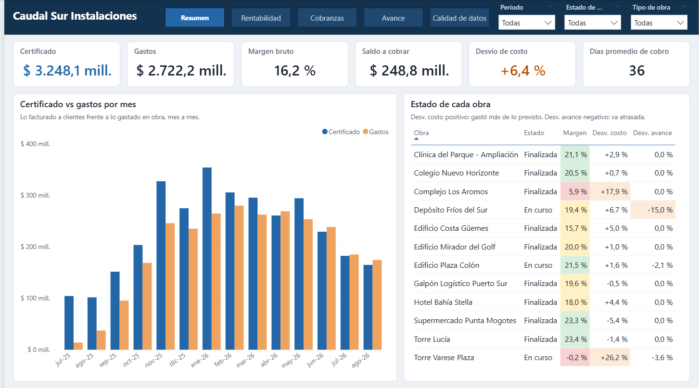
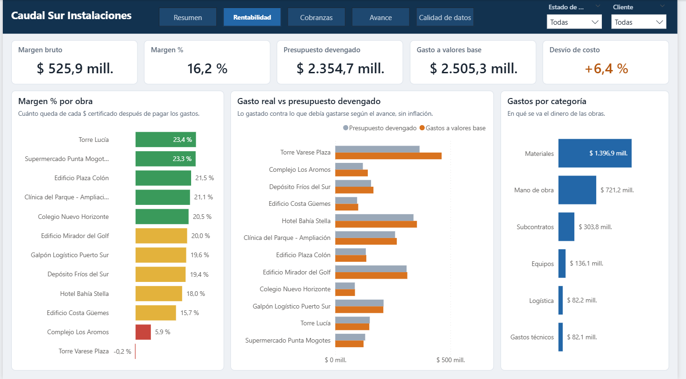
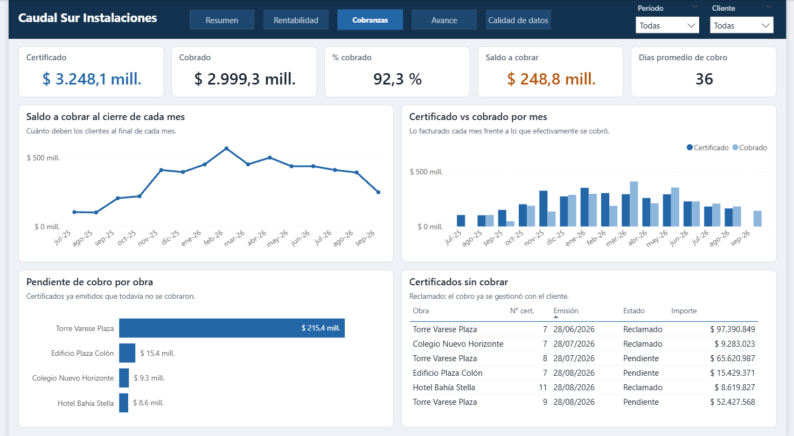
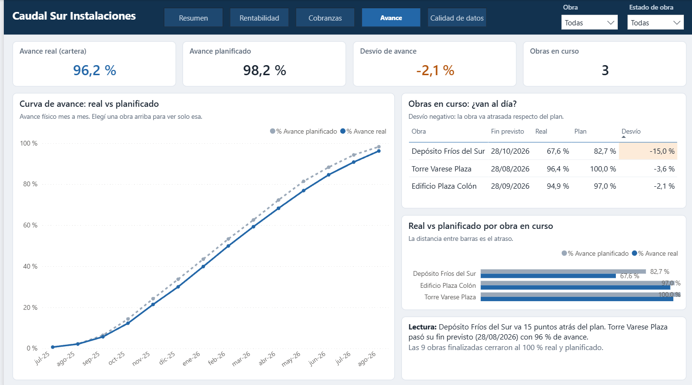
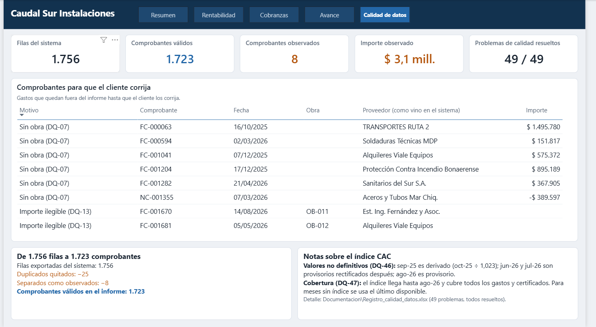

# Control de obras de una empresa de instalaciones en Mar del Plata

Este proyecto es un informe de Power BI para Caudal Sur Instalaciones S.R.L., una empresa de Mar del Plata que hace instalaciones sanitarias y redes contra incendio en edificios, galpones y comercios. Cubre 12 obras entre julio de 2025 y septiembre de 2026: 1.723 comprobantes de compra, 104 certificados emitidos a clientes y el avance físico mensual de cada obra. La idea fue armar algo que pueda usar el dueño para saber, de un vistazo, qué obras le dejan plata, cuáles se están yendo de presupuesto, cuánto le deben los clientes y cuáles vienen atrasadas.

> **Nota:** los datos son ficticios. El dataset fue generado para practicar, con errores de carga parecidos a los de un sistema real (duplicados, códigos escritos de distintas formas, fechas y montos en formatos mezclados). Las cifras no corresponden a ninguna empresa existente.



## Qué pregunta busca responder

- ¿Cuánto se certificó, cuánto se gastó y qué margen deja cada obra?
- ¿Qué obras gastaron más de lo presupuestado, una vez que se saca el efecto de la inflación?
- ¿Cuánto deben los clientes, cómo evolucionó esa deuda y quién la concentra?
- ¿Las obras en curso van al día o vienen atrasadas respecto del plan?
- ¿Qué datos del sistema no se pudieron usar y hay que pedirle al cliente que corrija?

## Estructura del informe

El archivo tiene cinco páginas con un encabezado común: navegación entre páginas y filtros por período, estado de obra, tipo de obra, cliente u obra, según la página. Cada visual tiene un subtítulo corto que explica qué muestra.

1. **Resumen**: certificado, gastos, margen, saldo a cobrar, desvío de costo y días promedio de cobro; certificado contra gastos por mes y una tabla con el estado de cada obra (margen con semáforo, desvío de costo y desvío de avance).
2. **Rentabilidad**: margen por obra, gasto real contra presupuesto devengado y gastos por categoría.
3. **Cobranzas**: saldo a cobrar al cierre de cada mes, certificado contra cobrado, deuda por obra y detalle de los certificados sin cobrar.
4. **Avance**: curva de avance real contra planificado (de toda la cartera o de una obra), obras en curso y su atraso.
5. **Calidad de datos**: los comprobantes que quedaron fuera del informe, el recorrido de la limpieza y notas sobre el índice CAC.

### Resumen


### Rentabilidad



### Cobranzas



### Avance



### Calidad de datos



## Cómo está armado

### Limpieza en Power Query

Los datos venían de cinco archivos (un CSV exportado del sistema de compras y planillas de Excel de obras, certificaciones y avance) con los errores típicos de una carga manual. Antes de tocar nada armé un **registro de calidad de datos** en Excel (`Documentacion/Registro_calidad_datos.xlsx`) con 49 problemas: archivo, columna, ejemplo, decisión tomada y estado. Cada paso de Power Query lleva en el nombre el número del problema que resuelve (por ejemplo, `DQ-43 Valores a fracción 0-1`), así se puede seguir de punta a punta. Algunos de los más importantes:

- **25 comprobantes duplicados**: quité las copias por número de comprobante. Cuando una copia tenía el importe ilegible (`#VALOR!`) y la otra no, me quedé con la válida.
- **Fechas en cuatro formatos** (2026-01-02, 07/07/2026, 02/08/25, 02-08-25): una función propia en M que reconoce cada uno.
- **El mismo código de obra escrito de cuatro formas** (OB-001, ob-001, OB001, OB 001, algunos con un espacio invisible adelante): normalización a OB-XXX.
- **29 formas de escribir los 12 proveedores** (SANITARIOS DEL SUR, Sanitarios Del Sur SA…): una tabla de equivalencias hacia el ID del proveedor.
- **Rubros vacíos**: los completé con el rubro principal del proveedor, después de comprobar que cada proveedor siempre carga al mismo rubro.
- **El avance en formato ancho** (un mes por columna, con porcentajes en tres escalas: 0,29, 29 % y 29,2): anulé la dinamización y llevé todo a una fracción entre 0 y 1.
- **Un CSV con comas dentro de los textos** que cortaba "Rociadores, válvulas y equipos" en dos columnas: importación respetando las comillas.

Los comprobantes que no se podían usar (6 sin obra y 2 con importe ilegible) no los borré: quedaron en una tabla aparte, **Gastos_Observados**, para que el cliente los corrija.

### Modelo de datos

Modelo en estrella:

- **Hechos**: gastos (una fila por comprobante), certificaciones (una por certificado), avance (una por obra y mes) y gastos observados.
- **Dimensiones**: obras, rubros, proveedores, índice CAC y un **calendario** creado con DAX y marcado como tabla de fechas.

Las certificaciones tienen tres fechas (emisión, cobro y período certificado). La relación activa con el calendario es la de emisión; las otras dos quedan inactivas y las uso dentro de las medidas con `USERELATIONSHIP`, para poder ver lo cobrado en el mes en que realmente entró la plata.

Las medidas están en una tabla aparte, organizadas en carpetas:

- **Gastos**: gastos, comprobantes, notas de crédito y gastos observados.
- **Certificaciones**: certificado, cobrado, pendiente de cobro, saldo a cobrar acumulado al cierre de cada mes, % cobrado y días promedio de cobro.
- **Rentabilidad**: margen bruto y margen %.
- **Presupuesto y CAC**: índice CAC del período, presupuesto y precio de contrato actualizados, gastos a valores base, presupuesto devengado y desvío de costo.
- **Avance**: avance real, avance planificado y desvío. Con varias obras es el avance acumulado de toda la cartera: cada obra aporta su último avance informado (las terminadas, 100 %; las que no empezaron, 0 %), ponderado por su precio de contrato. Por eso la curva nunca baja y su último mes coincide con las tarjetas.

Dos decisiones importantes:

- **Comparar contra el presupuesto sin la inflación.** El presupuesto de cada obra está a valores de su mes base. Si se compara directo con los gastos en pesos corrientes, cualquier obra parece pasada de presupuesto solo por la inflación. Por eso cada gasto se lleva al mes base de su obra con el índice CAC (índice del costo de la construcción).
- **Comparar contra lo que se debería haber gastado, no contra el total.** Una obra al 68 % de avance no debería haber gastado el 100 % de su presupuesto. El desvío se calcula contra el **presupuesto devengado** (presupuesto × avance real). Con la comparación contra el total, una obra en curso aparecía 28 % por debajo del presupuesto cuando en realidad venía 7 % arriba.

## Lo que muestran los datos

- **La empresa gana, pero con un margen ajustado.** Certificó $3.248,1 millones y gastó $2.722,2 millones: un margen del 16,2 %. Una vez sacada la inflación, gastó un 6,4 % más de lo que correspondía según el avance de las obras.
- **Torre Varese Plaza es la obra problemática.** Tiene margen negativo (−0,2 %), un sobrecosto del 26,2 % sobre su presupuesto devengado, pasó su fecha de fin prevista (28/08/2026) con el 96,4 % de avance y concentra el 87 % de la deuda de clientes ($215,4 millones de $248,8 millones).
- **Complejo Los Aromos terminó con un sobrecosto del 17,9 %** y un margen del 5,9 %, muy por debajo del resto de las obras finalizadas.
- **Depósito Fríos del Sur va 15 puntos atrás del plan** (67,6 % real contra 82,7 % planificado) y ya gasta un 6,7 % más de lo previsto para su avance.
- **La cobranza funciona bien salvo una obra.** Se cobró el 92,3 % de lo certificado, a 36 días promedio desde la emisión. La deuda llegó a su pico en febrero de 2026, por encima de los $500 millones, y bajó a $248,8 millones en septiembre.
- **Materiales y mano de obra propia son el 78 % del gasto** ($1.396,9 millones y $721,2 millones).

**Recomendación principal:** poner el foco en Torre Varese Plaza: reclamar los tres certificados pendientes, revisar con el cliente los costos extra para negociar una actualización del precio y analizar qué salió mal para no repetirlo. En paralelo, armar un plan de recupero de plazos en Depósito Fríos del Sur antes de que el atraso se transforme en más sobrecosto.

## Limitaciones

- Los datos son ficticios y cubren un solo ciclo de obras, así que no hay comparación con años anteriores.
- Algunos valores del índice CAC no son definitivos (septiembre de 2025 es derivado y junio a agosto de 2026 son provisorios). Se usan igual y el informe lo aclara.
- El avance es el que informa la empresa una vez por mes; no hay mediciones intermedias.
- El margen está en pesos corrientes: compara lo certificado y lo gastado sin ajustarlos por inflación entre meses.

## Herramientas

- Power BI Desktop, en formato **Proyecto de Power BI (.pbip)**: el modelo está guardado en TMDL, así el código M y las medidas DAX se leen como texto y cada cambio queda registrado en git
- Power Query para la limpieza (con una función propia para las fechas y una tabla de equivalencias)
- DAX para las medidas y la tabla calendario
- Excel para el registro de calidad de datos
- Git para el historial de cambios

## Estructura de la carpeta

```
Caudal Sur Instalaciones SRL.pbip                         ← abrir este
Caudal Sur Instalaciones SRL.SemanticModel/definition/   ← modelo en TMDL (código M y DAX en texto)
Caudal Sur Instalaciones SRL.Report/                     ← páginas, visuales y tema
Datos crudos/                                            ← fuentes originales, no se modifican
Documentacion/                                           ← registro de calidad de datos
capturas/                                                ← imágenes de cada página
```

## Cómo verlo

1. Descargá o cloná el repositorio.
2. Abrí `Caudal Sur Instalaciones SRL.pbip` con Power BI Desktop (es gratuito).
3. Los datos se leen de la carpeta `Datos crudos`. Si la guardaste en otro lugar, cambiá la ruta del origen en Power Query y actualizá.
